# StickyPad

**Colourful sticky notes for Windows, with a local AI helper that understands Greek and English.**

Each note is its own small window on your desktop. Everything is stored on your PC; nothing leaves it unless you choose an online AI provider.

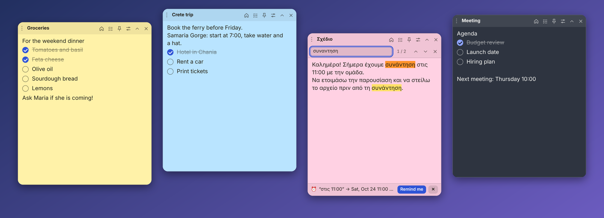

- **Light and simple**: one small window per note, a tray icon, and it can start with Windows.
- **Private**: no account, no cloud. Lock a note with a password, or keep the AI on your own PC with [Ollama](https://ollama.com).
- **Greek-friendly**: the AI has dedicated Greek rules (accents, spelling), and search ignores Greek accents.
- **Tells you about updates** from this repository's Releases: you press **Download**, then **Restart to update** when it is ready.
- **Easy on memory**: Low memory mode (on by default) and an AI model that only stays loaded while you use it. *Settings > About > Measure* shows what StickyPad uses.

[Download the latest installer](../../releases/latest) · [What's new](CHANGELOG.md) · [Report a problem](../../issues)

---

## Everything it can do

### Notes
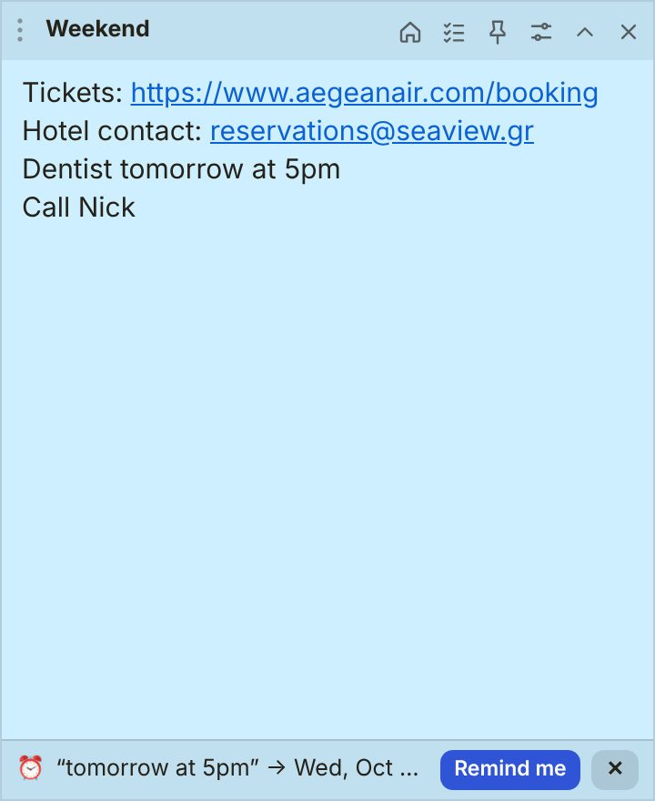

- **Colours, 9 themes, any font and size.** Pick a colour per note, or apply a theme to one note or all of them.
- **Checklists** (Ctrl+Shift+C): tick items off, *Remove ticked* clears the finished ones, *Make plain text* turns them back into lines.
- **Pictures**: paste or drop them straight into the text.
- **Links**: web and e-mail addresses are underlined; **Ctrl+click** opens them, and a right-click offers *Open link* and *Copy link*. The note on the right shows links, a date suggestion and the update bar.
- **Pin** a note on top of other windows, **roll it up** to just its title, or **close** it and reopen it from the tray.
- **Folders** to group notes; **snap** to screen edges and to other notes; **tidy up** arranges the open notes in rows.
- **Trash** keeps deleted notes for 30 days, so nothing is lost by accident.

The icons in the header, from the left: add a checklist item, pin, all notes, settings, roll up, close.

### Settings panel on the right
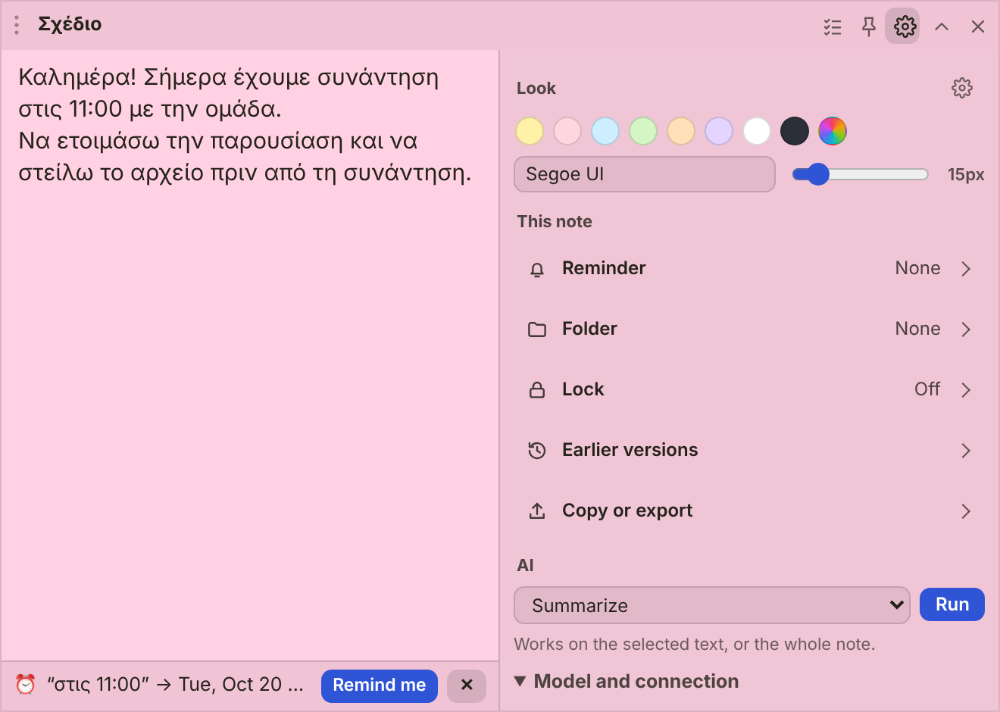

The **sliders button** (*This note*) opens a panel **beside your text instead of on top of it**, so you can keep reading the note while you change its colour, set a reminder or run the AI. A narrow note grows to make room while the panel is open and returns to its size when you close it. It is **one short list, no tabs**: *Look* (colour, and a *Font and transparency* drop down), *This note* (Reminder, Folder, Lock, Earlier versions, Copy or export: each is one line and only the one you click opens) and *AI* (one list and a **Run** button). **All settings…** at the bottom of the panel (or Ctrl+,) opens the full Settings. Everything about *the app* (start with Windows, snapping, shortcuts, backups) lives in Settings only, so each thing has one place.

 

### Find in a note (Ctrl+F)
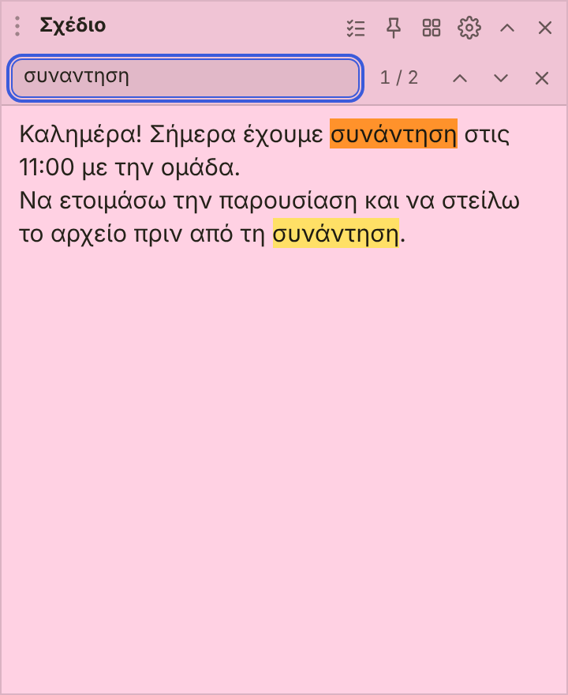

A search bar appears with **every match highlighted** and the current one in orange. Press **Enter / Shift+Enter** (or F3) to jump between matches; the counter shows where you are. It ignores capital letters **and Greek accents**, so `συναντηση` finds `συνάντηση`, and it searches inside checklist items too. Searching never changes your text, and it copes with very long notes (it highlights up to 5,000 matches).

### Text prediction
After three letters of a word you have used before, a small list offers it. **Tab** finishes the word (Ctrl+Z takes back just that), **Up/Down** then **Enter** pick another, **Esc** closes it. It learns from your notes (never from locked ones) and works with Greek. Switch it off in *Settings > General*.

### Reminders
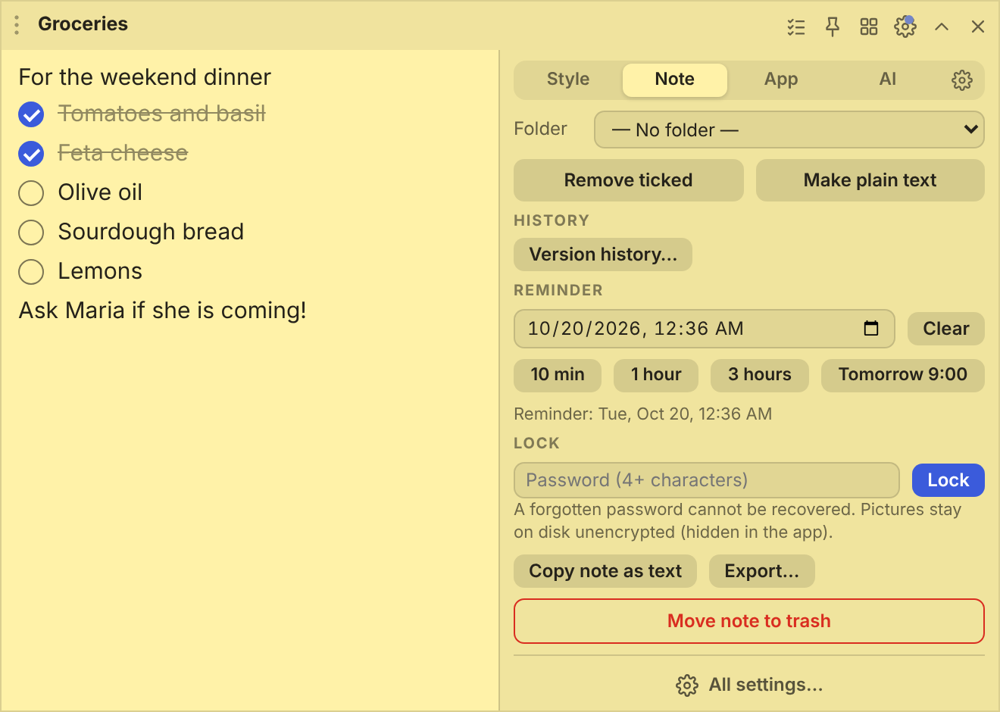

Open the sliders button (*This note*) and click **Reminder**. Pick a date and time, or press **10 min**, **1 hour**, **3 hours** or **Tomorrow 9:00**. When the time comes, **Windows shows a notification and clicking it opens the note**. A reminder that came due while StickyPad was closed fires the next time you start it. A small dot on the sliders button shows that a note has a reminder.

A small bar also appears when a note **mentions a date** ("tomorrow at 5pm", "αύριο στις 17:30", "15/11 10:00", "in 2 hours") and offers to set the reminder for it. It works without the AI, in Greek and English, and can be switched off in Settings.

### Version history
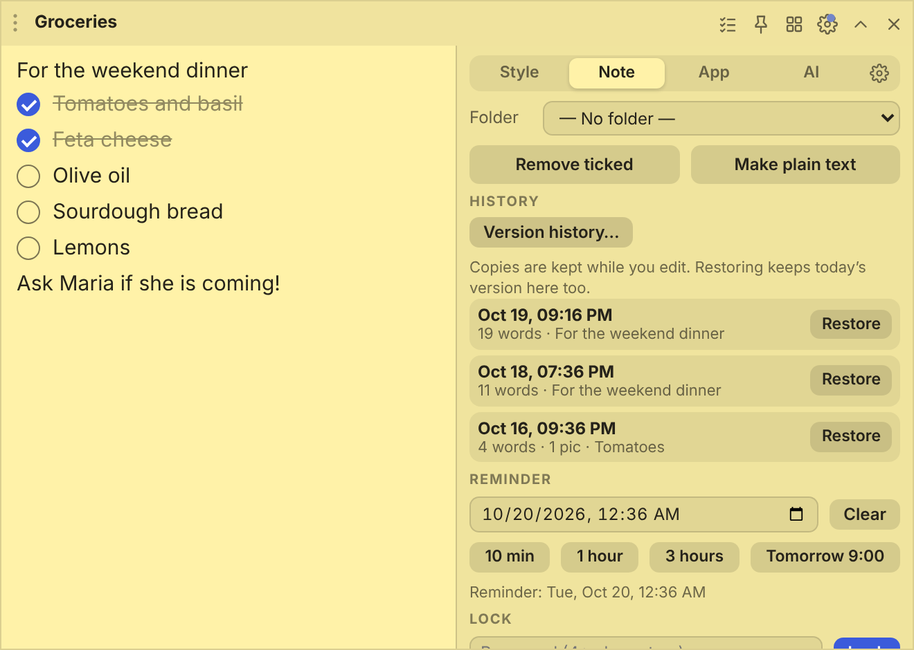

StickyPad quietly keeps **up to 30 older copies of each note** while you edit: at least one every 5 minutes, and always one right before a sudden big deletion (for example Ctrl+A then Delete). Open the sliders button (*This note*) and click **Earlier versions**, see each copy with its time, word count and a preview, and press **Restore** (it asks once more to be sure). Restoring keeps today's version in the list as well, so you can always go back. Locked notes keep no copies, so nothing readable is left behind.

### Export and import
- **Copy or export > Export…** (in the note panel) saves the note as a **StickyPad note (.stickypad)**, a **Markdown (.md)** or a **text (.txt)** file. A `.stickypad` file is Markdown inside and **opens with a double-click** (it becomes a new note). Checklist items become `- [x] done` and `- [ ] to do`.
- **Settings > Data & backup > Export all notes** writes one file per note, in folders that match your note folders.
- **Import from other apps** reads **Google Keep** (the `.json` files from Google Takeout) and **Windows Sticky Notes**.
- **Import notes** turns `.stickypad`, `.md` and `.txt` files into notes. A first line `# Title` becomes the note's topic and lines like `- [ ] item` become checklist items.
- **Copy note as text** (Ctrl+Shift+T) puts the whole note on the clipboard.

Pictures are included: **.stickypad** and Markdown files carry them inside the file, and importing puts them back. Plain text (.txt) files cannot hold pictures.

### Home: notes, trash, AI chat and settings in one window
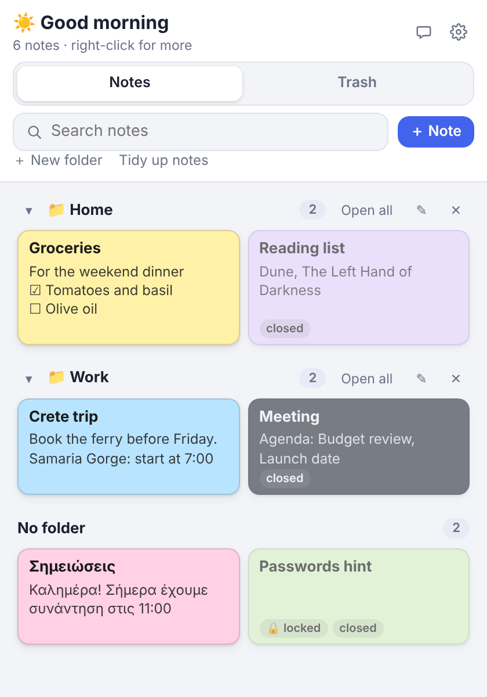

Ctrl+Alt+A, the tray icon, or the **house button** at the left of any note's title bar opens the **Home** window. A sidebar switches between **Notes** (every note as a card, with search, *Open all* per folder and *Tidy up*; **folder chips** show one folder at a time, and dropping a card on a chip moves the note there), **Trash**, **Ask the AI** (the chat) and **Settings**. It is always the same one window, so nothing gets lost behind others. Closed notes are greyed out; click one to open it.

### Search all notes
Press **Ctrl+Alt+F** (or *Search notes…* in the tray menu) from anywhere: a small search window opens in the middle of your screen. Type a few letters and the notes that contain **all** your words appear at once, best match first, each with a short piece of its text and the matching words marked. **Up and Down** choose, **Enter** opens the note, **Esc** (or a click elsewhere) closes it. It reads the **whole text** of every note, ignores capitals and accents (so *καλημερα* finds *Καλημέρα*), and notes with a lock are found by their title only. The search box in the Home window uses the same search.

### Lock
Give a note a password (4+ characters) and its text is stored **encrypted (AES-256-GCM)**. It shows a lock screen until you enter the password. A forgotten password cannot be recovered. Pictures stay on disk unencrypted, but are hidden in the app.

### AI helper (off by default)
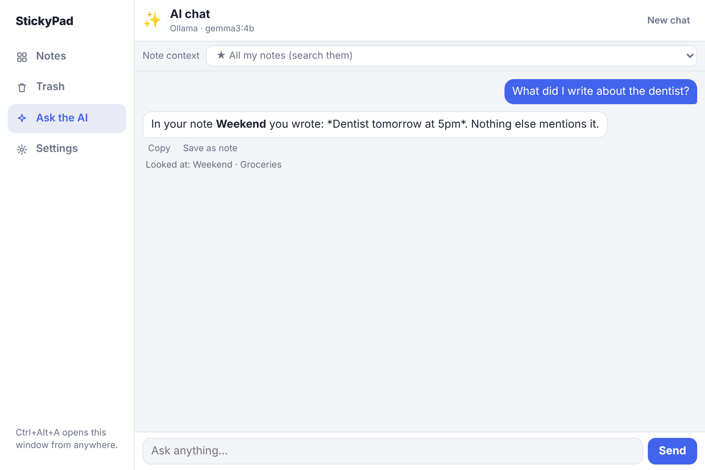

Open the sliders button (*This note*): the **AI** part is one list and a **Run** button (the model and connection options are folded under *Model and connection*, and open by themselves when something needs fixing):

| In the list | What it does |
|---|---|
| **Summarize** | A short summary of the note, in the note's own language. |
| **Fix spelling and grammar** | Finds mistakes and shows each change, so you can **Apply** or **Cancel**. |
| **Turn into a checklist** | Turns the note into a clean checklist. |
| **Suggest a title** | A short title for the note. |
| **Translate Greek ⇄ English** | **Greek → English**, anything else → Greek, right in the note. Works on the selected text, or the paragraph with the cursor. |
| **Polish / shorter / friendlier / fix it right in the note / continue writing** | The model rewrites the selected text **right in the note as it types** (Ctrl+Shift+E does it too). **Stop** cancels, **Undo** brings the original back. |

Under *Look*, a **Transparency** bar makes the note see-through (0 to 70%), one setting per note. *Keep the text solid* fades only the background (it needs *Low memory mode* off in *Settings > General*).

**Chat about this note** (bottom of the panel) opens the AI chat with the note, or **all your notes** (pick *★ All my notes*). With a note attached, **Apply to note** under an answer puts it into the note (replace it or add at the end; the old text stays in *Earlier versions*). In the chat, the **🧠 model chip** under the messages switches between your installed models without leaving the chat.

- Works with **Ollama on your PC (free, private)** or the **Claude API (online)**.
- A built-in **model list** offers current models from 1.4 GB to 9 GB (**Gemma 4**, **Qwen3**, Gemma 3, Llama 3.2), each with a note on how good its Greek is, and downloads them with a progress bar. A model that does not work well for you can be removed again with **Delete model…** to free the disk space. If Ollama itself is missing, one button downloads and installs it.
- If the model you picked is not downloaded, or Ollama is not running, the AI tab tells you **right away** and shows where to press Download.
- **Your note is never mistaken for an instruction**: it is sent to the model clearly marked as text to work on, so a note that says "Call Nick" gets summarised or edited, not answered. Reasoning models such as Qwen3 are told not to "think out loud" (faster, and nothing odd appears in your note).
- **Long notes** are processed in pieces, so even a very large note is handled completely.
- **Greek** has dedicated rules (accents, final ς, spelling) and a guard: if the model answers in English or rewrites your text too heavily, the answer is discarded and your original stays.

### Several screens
StickyPad remembers which screen each note is on. Unplug a monitor and its notes move to your main screen; plug it back in and they return to where they were.

### Sync, backup and your data
- **Use your notes on every PC**: *Settings > Data & backup > Choose folder…* moves the data into a folder kept in sync by OneDrive, Dropbox, Google Drive or Syncthing. Choose the same folder on your other PCs; changes appear within seconds. If two PCs edit at the same moment, the other version is saved in a `conflicts` folder, never lost.
- **Automatic backups** once a day (the newest 7 are kept) and a *Back up now* button.
- **SQLite export/import** (`tools/stickypad_db.py`) for other apps or a future Android version.
- Saves are crash-safe: files are written atomically.

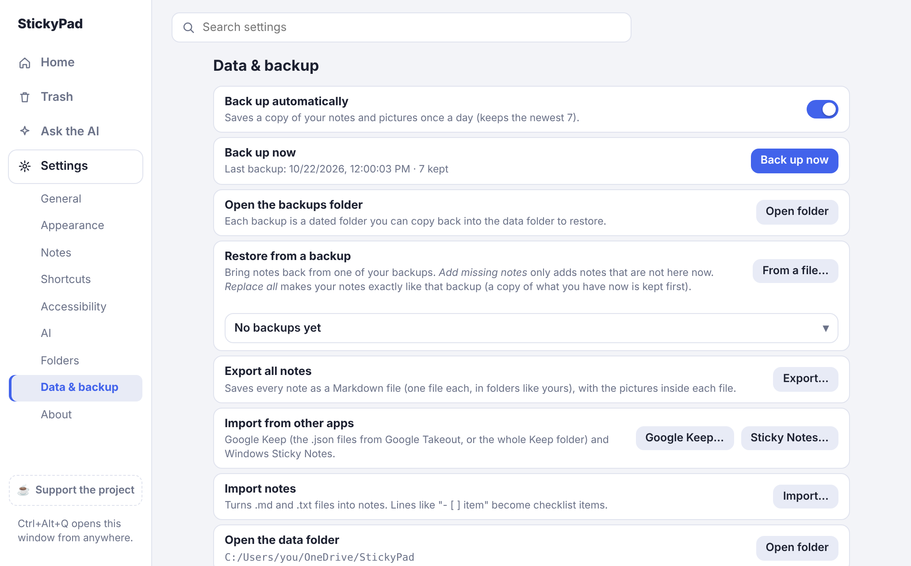

### Updates
StickyPad checks this repository's Releases when it starts and every few hours. When a newer version is found, a small bar at the bottom of your notes says so with a **Download** button (nothing is downloaded until you press it). While it downloads, a glowing **neon progress bar** shows how far it is; when it is ready the bar offers **Restart to update** (or ✕ for later; no Windows dialog). If you ignore it, a downloaded update installs when you quit. The first time StickyPad starts after an update it shows a **What's new** window with what changed (switch it off there or in *Settings > About*). *Settings > About* has a switch, a **Check now** button, the same Download and Restart buttons, and, if anything goes wrong, **Open update log** and **Releases page**.

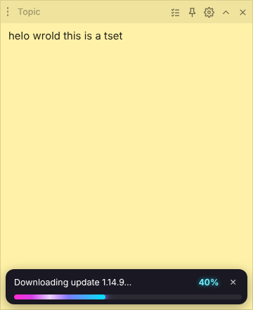 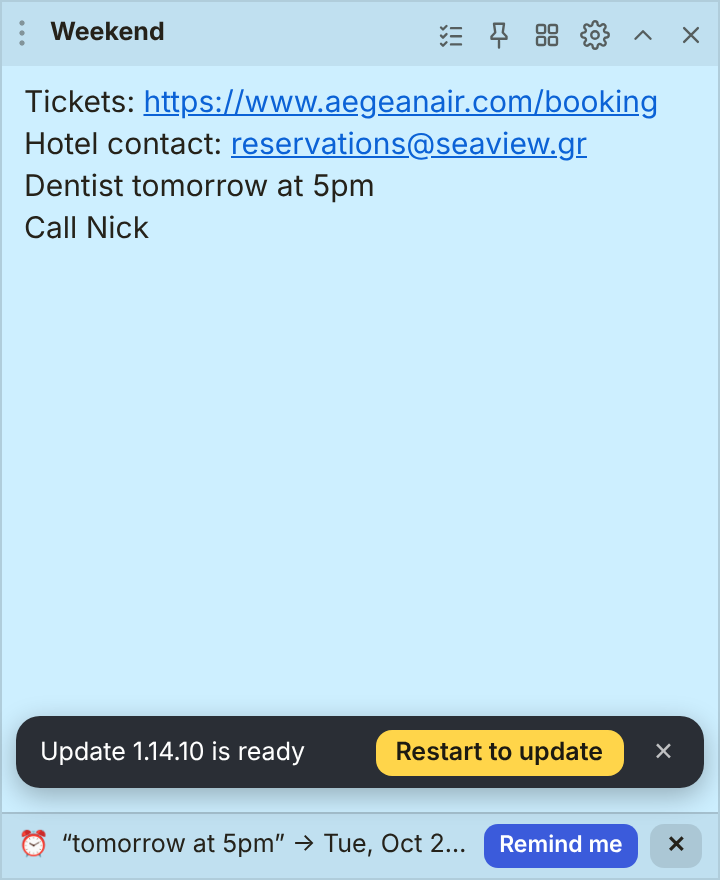

### Themes, light and dark
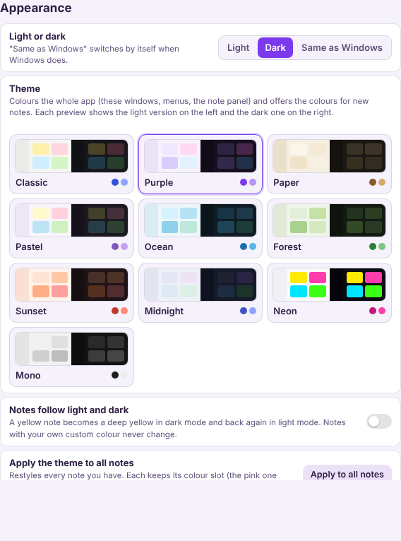

A theme colours **the whole app**: the Home window, Settings, the AI chat, the note panel, and the colours offered for notes. There are **10 themes** (Classic, Purple, Paper, Pastel, Ocean, Forest, Sunset, Midnight, Neon, Mono), and **every theme has a light and a dark version**.

- *Settings > Appearance > Light or dark*: **Light**, **Dark** or **Same as Windows** (switches by itself when Windows does).
- **Notes follow light and dark** (on by default): a yellow note becomes a deep yellow in dark mode and goes back in light mode. Notes with your own custom colour never change.
- Every theme is checked for readable text (WCAG AA contrast) in both versions, and a note picks dark or light text by itself, whichever reads better on its colour.
- Pick a colour, font and size per note in the note's **Style** tab.

 
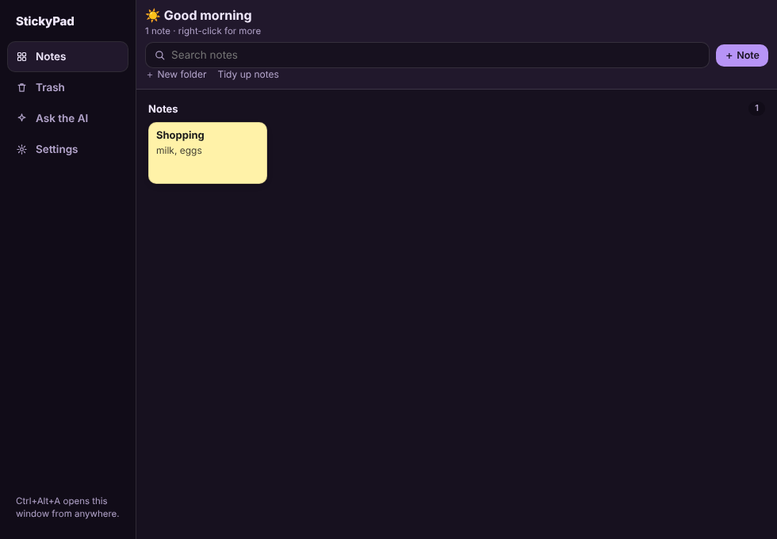
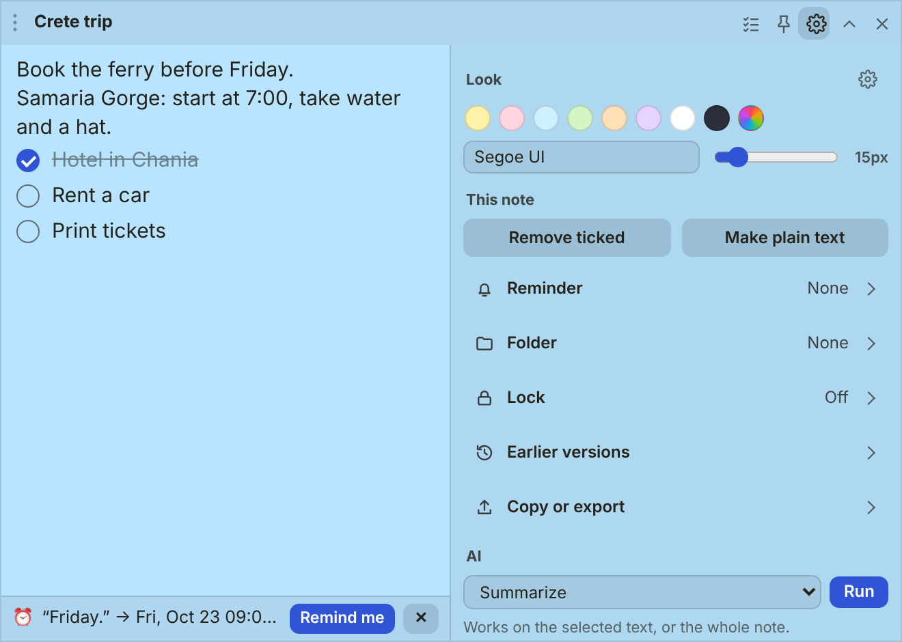

---

## Install
Download **StickyPad-Setup-x.y.z.exe** from the [Releases](../../releases) page and run it. Windows SmartScreen may warn because the app is not code-signed; choose "More info", then "Run anyway".

### Local AI in two minutes
1. Open a note, click the sliders button (*This note*), go to the **AI** part, set *Use* to **Ollama**
2. If you see "Ollama is not installed", press **Download and install Ollama**
3. Choose a model from the list (for Greek try *Gemma 4 E4B* on a PC with 16 GB of RAM, *Qwen3 8B*, or *Gemma 3 4B* on 8 GB) and wait for the download
4. Select text (or put the cursor in a paragraph) and press **Edit live** (Ctrl+Shift+E) or **Translate**

## Shortcuts
| In a note | |
|---|---|
| Ctrl+N | new note |
| Ctrl+F | find in the note |
| Ctrl+Shift+C | add a checklist item |
| Ctrl + mouse wheel | bigger / smaller text |
| Tab | finish the word offered by text prediction (Esc closes the list) |
| Ctrl+Shift+E | live AI edit |
| Ctrl+Shift+T | copy the note as plain text |
| Ctrl+, | all settings |

Every shortcut below can be changed in **Settings > Shortcuts**: press *Change*, then the keys you want. Clashes are flagged and *Reset* restores the default.

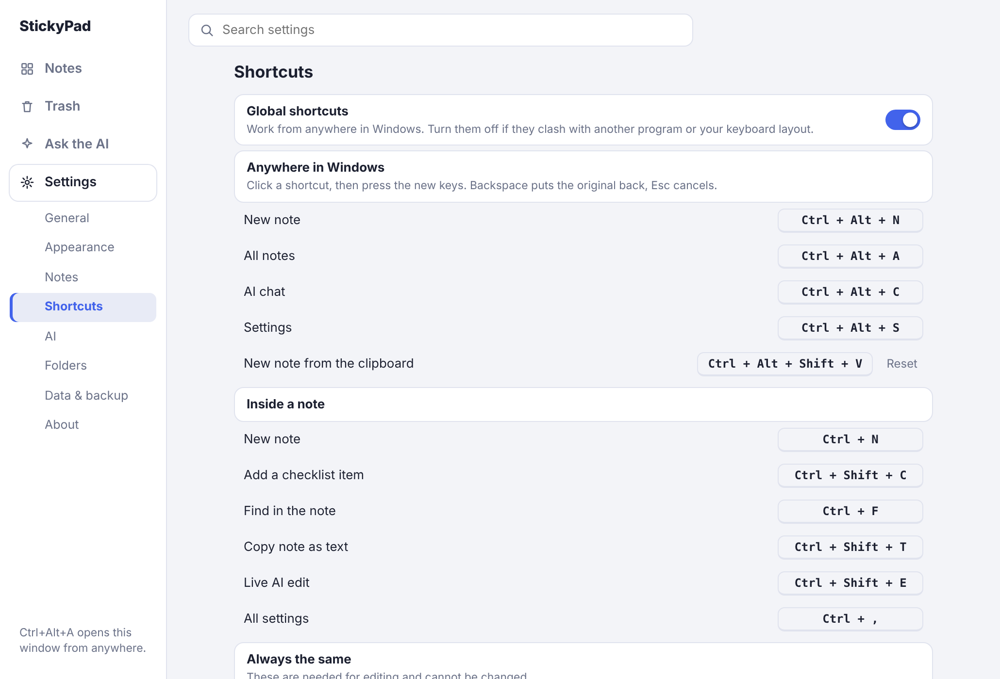

| Anywhere in Windows (Settings > Shortcuts can turn these off) | |
|---|---|
| Ctrl+Alt+N | new note |
| Ctrl+Alt+A | all notes |
| Ctrl+Alt+C | AI chat |
| Ctrl+Alt+S | settings |
| Ctrl+Alt+V | new note from the clipboard |
| Ctrl+Alt+F | **search all notes** (small search window) |

## Your data
Stored in `%APPDATA%\StickyPad` (`notes.json`, `images/`, `history/`, `chat.json`). Move it with *Settings > Data & backup > Choose folder*. See [docs/ARCHITECTURE.md](docs/ARCHITECTURE.md) for the data format and how the pieces fit together.

## Build it yourself
Needs [Node.js LTS](https://nodejs.org). If you double-click `build.bat` or `start-dev.bat` and Node.js is missing, they download a private copy for you (checked against nodejs.org's checksum, no administrator rights needed).

    npm install
    npm start          # run from source
    npm run dist       # build the installer into dist/

On Windows you can double-click `build.bat` or `start-dev.bat` instead. `build.bat` can also delete the roughly 1 GB of build leftovers afterwards.

## Development
    npm test                       # unit tests (Node), also run on every push
    python tests/test_db.py        # SQLite export/import
    python tests/ui/t_find.py      # browser tests of the note and settings screens (need Playwright)
    python tools/screenshots.py    # regenerates the pictures in docs/images from the real screens

Publishing a release: see [docs/RELEASING.md](docs/RELEASING.md). There is also an early, experimental **Tauri** build (much smaller installer, fewer features) in `src-tauri/`; the Electron app above is the one to use.

Pull requests are welcome. Electron and Ollama behaviour on real hardware is only partly covered by the automated tests, so please report anything odd.

## Licence
[MIT](LICENSE)
