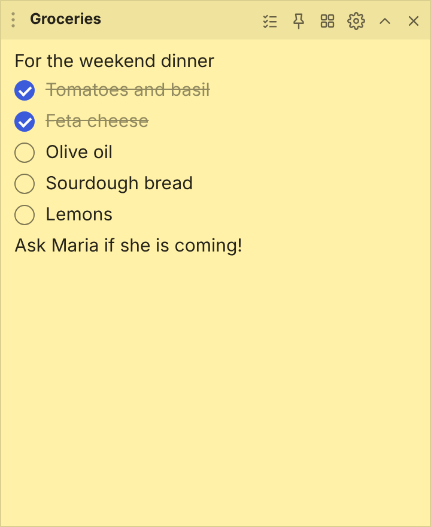

# StickyPad

**Colourful sticky notes for Windows, with a local AI helper that understands Greek and English.**

Each note is its own small window on your desktop. Everything is stored on your PC; nothing leaves it unless you choose an online AI provider.

- **Light and simple**: one small window per note, a tray icon, and it can start with Windows.
- **Private**: no account, no cloud. Lock a note with a password, or keep the AI on your own PC with [Ollama](https://ollama.com).
- **Greek-friendly**: the AI has dedicated Greek rules (accents, spelling), and search ignores Greek accents.
- **Updates itself** from this repository's Releases.
- **Easy on memory**: Low memory mode (on by default) and an AI model that only stays loaded while you use it. *Settings > About > Measure* shows what StickyPad uses.

[Download the latest installer](../../releases/latest) · [What's new](CHANGELOG.md) · [Report a problem](../../issues)

---

## Everything it can do

### Notes

- **Colours, 9 themes, any font and size.** Pick a colour per note, or apply a theme to one note or all of them.
- **Checklists** (Ctrl+Shift+C): tick items off, *Remove ticked* clears the finished ones, *Make plain text* turns them back into lines.
- **Pictures**: paste or drop them straight into the text.
- **Pin** a note on top of other windows, **roll it up** to just its title, or **close** it and reopen it from the tray.
- **Folders** to group notes; **snap** to screen edges and to other notes; **tidy up** arranges the open notes in rows.
- **Trash** keeps deleted notes for 30 days, so nothing is lost by accident.

The icons in the header, from the left: add a checklist item, pin, all notes, settings, roll up, close.

### Find in a note (Ctrl+F)

A search bar appears with **every match highlighted** and the current one in orange. Press **Enter / Shift+Enter** (or F3) to jump between matches; the counter shows where you are. It ignores capital letters **and Greek accents**, so `συναντηση` finds `συνάντηση`, and it searches inside checklist items too. Searching never changes your text, and it copes with very long notes (it highlights up to 5,000 matches).

### Reminders

Open the gear, tab **Note**, **Reminder**. Pick a date and time, or press **10 min**, **1 hour**, **3 hours** or **Tomorrow 9:00**. When the time comes, **Windows shows a notification and clicking it opens the note**. A reminder that came due while StickyPad was closed fires the next time you start it. A small dot on the gear shows that a note has a reminder.

### Version history

StickyPad quietly keeps **up to 30 older copies of each note** while you edit: at least one every 5 minutes, and always one right before a sudden big deletion (for example Ctrl+A then Delete). Open **Note > Version history…**, see each copy with its time, word count and a preview, and press **Restore** (it asks once more to be sure). Restoring keeps today's version in the list as well, so you can always go back. Locked notes keep no copies, so nothing readable is left behind.

### Export and import
- **Note > Export…** saves the note as a **Markdown (.md)** or **text (.txt)** file. Checklist items become `- [x] done` and `- [ ] to do`.
- **Settings > Data & backup > Export all notes** writes one file per note, in folders that match your note folders.
- **Import notes** turns `.md` and `.txt` files into notes. A first line `# Title` becomes the note's topic and lines like `- [ ] item` become checklist items.
- **Copy note as text** (Ctrl+Shift+T) puts the whole note on the clipboard.

Pictures are not included in exported files.

### All notes

Ctrl+Alt+A opens the **All notes** window: every note as a card, grouped by folder, with search, *Open all* per folder, a **Trash** tab, a button for the AI chat and one for settings. Closed notes are greyed out; click one to open it.

### Lock
Give a note a password (4+ characters) and its text is stored **encrypted (AES-256-GCM)**. It shows a lock screen until you enter the password. A forgotten password cannot be recovered. Pictures stay on disk unencrypted, but are hidden in the app.

### AI helper (off by default)

Open the gear, tab **AI**:

| Button | What it does |
|---|---|
| ✨ **Summarize** | A short summary of the note, in the note's own language. |
| ✨ **Fix grammar** | Finds spelling and grammar mistakes and shows each change, so you can **Apply** or **Cancel**. |
| ✨ **To checklist** | Turns the note into a clean checklist. |
| 🌐 **Translate** | **Greek → English**, anything else → Greek. Works on the selected text, or the paragraph with the cursor. |
| ✎ **Edit live** (Ctrl+Shift+E) | The model rewrites the selected text **right in the note as it types**: fix, polish, shorten, friendlier, translate or continue writing. **Stop** cancels, **Undo** brings the original back. |
| 💬 **Chat about it** | Opens a chat sidebar that knows the note. |

- Works with **Ollama on your PC (free, private)** or the **Claude API (online)**.
- A built-in **model list** offers ten models from 0.8 GB to 8 GB (Gemma 3, Qwen 2.5, Phi-4 mini, Mistral, Llama) and downloads them with a progress bar. If Ollama itself is missing, one button downloads and installs it.
- If the model you picked is not downloaded, or Ollama is not running, the AI tab tells you **right away** and shows where to press Download.
- **Long notes** are processed in pieces, so even a very large note is handled completely.
- **Greek** has dedicated rules (accents, final ς, spelling) and a guard: if the model answers in English or rewrites your text too heavily, the answer is discarded and your original stays.

### Sync, backup and your data
- **Use your notes on every PC**: *Settings > Data & backup > Choose folder…* moves the data into a folder kept in sync by OneDrive, Dropbox, Google Drive or Syncthing. Choose the same folder on your other PCs; changes appear within seconds. If two PCs edit at the same moment, the other version is saved in a `conflicts` folder, never lost.
- **Automatic backups** once a day (the newest 7 are kept) and a *Back up now* button.
- **SQLite export/import** (`tools/stickypad_db.py`) for other apps or a future Android version.
- Saves are crash-safe: files are written atomically.

### Updates
StickyPad checks this repository's Releases when it starts and every few hours. A newer version downloads in the background and asks whether to **restart now or later**; if you pick later it installs when you quit. *Settings > About* has a switch, a **Check now** button, and, if anything goes wrong, **Open update log** and **Releases page**.

### Themes and look

---

## Install
Download **StickyPad-Setup-x.y.z.exe** from the [Releases](../../releases) page and run it. Windows SmartScreen may warn because the app is not code-signed; choose "More info", then "Run anyway".

### Local AI in two minutes
1. Open a note, click the gear, choose the **AI** tab, set *Use* to **Ollama**
2. If you see "Ollama is not installed", press **Download and install Ollama**
3. Choose a model from the list (for Greek try *Gemma 3 4B*, *Qwen 2.5 7B* or *Gemma 3 12B*) and wait for the download
4. Select text (or put the cursor in a paragraph) and press **Edit live** (Ctrl+Shift+E) or **Translate**

## Shortcuts
| In a note | |
|---|---|
| Ctrl+N | new note |
| Ctrl+F | find in the note |
| Ctrl+Shift+C | add a checklist item |
| Ctrl+Shift+E | live AI edit |
| Ctrl+Shift+T | copy the note as plain text |
| Ctrl+, | all settings |

| Anywhere in Windows (Settings > Shortcuts can turn these off) | |
|---|---|
| Ctrl+Alt+N | new note |
| Ctrl+Alt+A | all notes |
| Ctrl+Alt+C | AI chat |
| Ctrl+Alt+S | settings |

## Your data
Stored in `%APPDATA%\StickyPad` (`notes.json`, `images/`, `history/`, `chat.json`). Move it with *Settings > Data & backup > Choose folder*. See [docs/ARCHITECTURE.md](docs/ARCHITECTURE.md) for the data format and how the pieces fit together.

## Build it yourself
Needs [Node.js LTS](https://nodejs.org). If you double-click `build.bat` or `start-dev.bat` and Node.js is missing, they download a private copy for you (checked against nodejs.org's checksum, no administrator rights needed).

    npm install
    npm start          # run from source
    npm run dist       # build the installer into dist/

On Windows you can double-click `build.bat` or `start-dev.bat` instead. `build.bat` can also delete the roughly 1 GB of build leftovers afterwards.

## Development
    npm test                       # unit tests (Node), also run on every push
    python tests/test_db.py        # SQLite export/import
    python tests/ui/t_find.py      # browser tests of the note and settings screens (need Playwright)
    python tools/screenshots.py    # regenerates the pictures in docs/images from the real screens

Publishing a release: see [docs/RELEASING.md](docs/RELEASING.md). There is also an early, experimental **Tauri** build (much smaller installer, fewer features) in `src-tauri/`; the Electron app above is the one to use.

Pull requests are welcome. Electron and Ollama behaviour on real hardware is only partly covered by the automated tests, so please report anything odd.

## Licence
[MIT](LICENSE)
